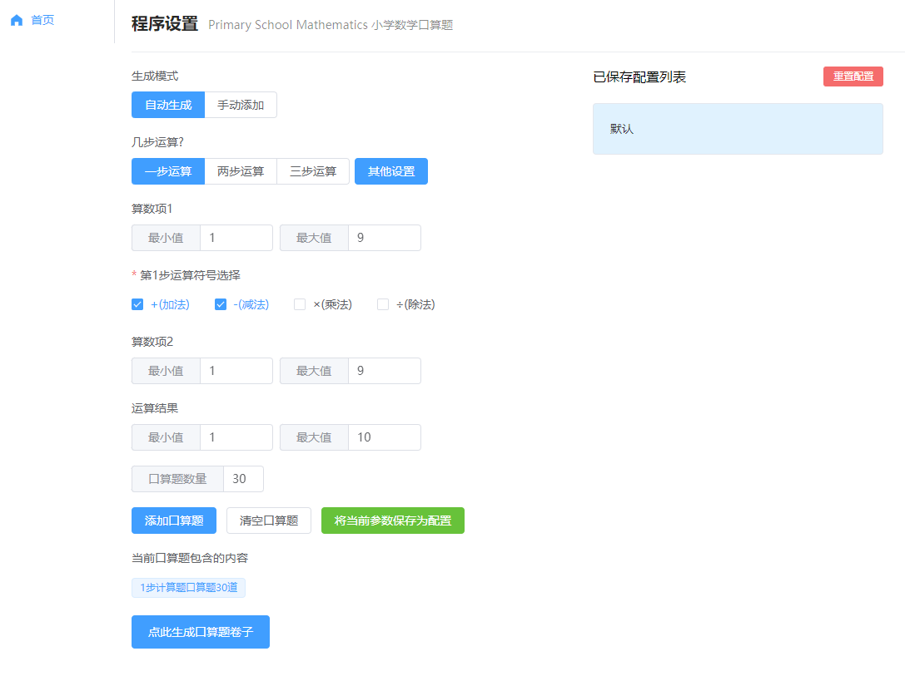
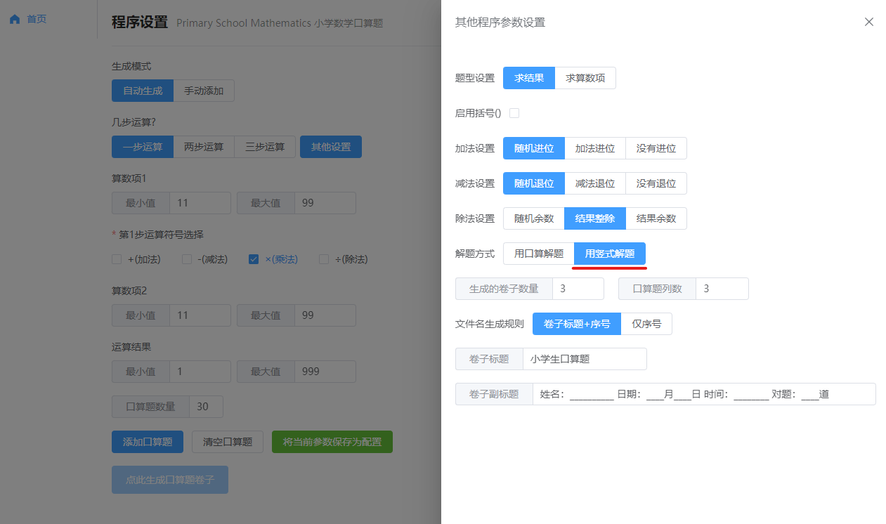
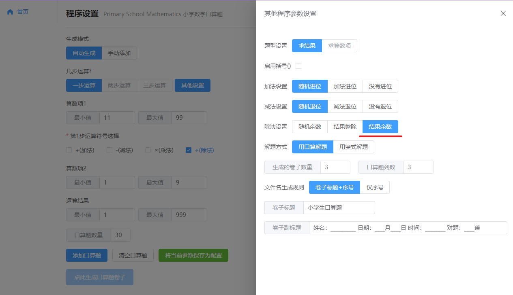
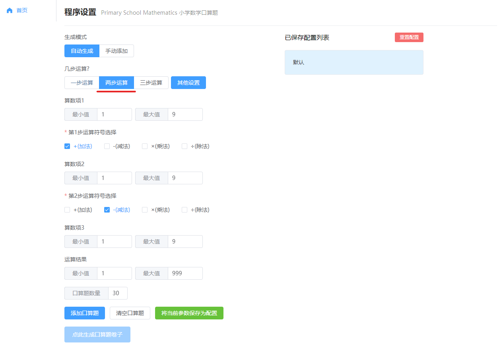
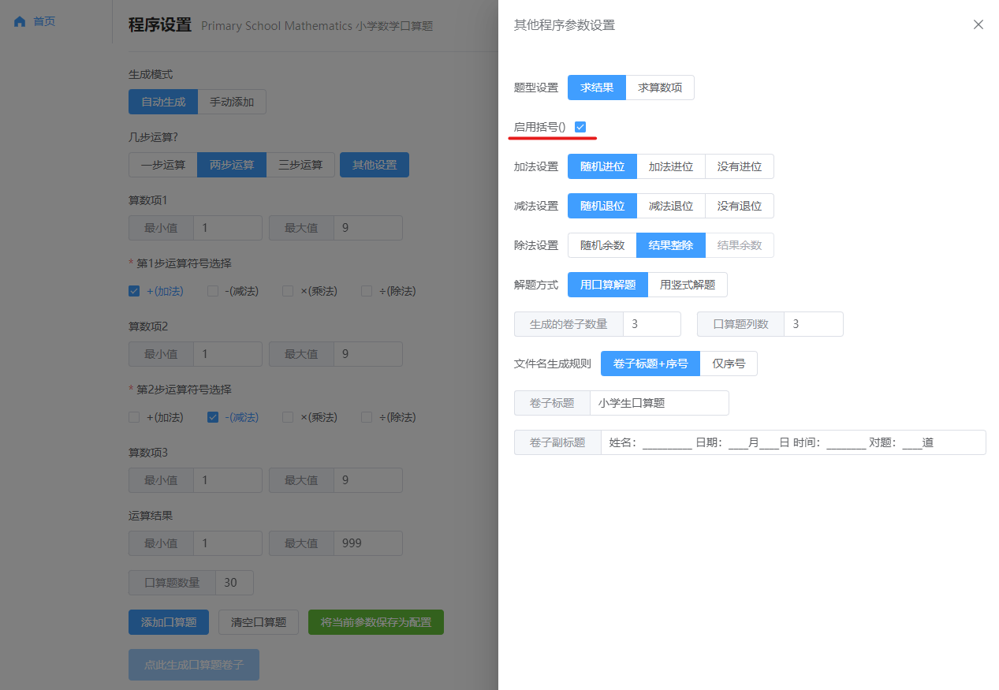

#  小学数学口算题 | Primary School Mathematics 2.1


## 背景 | Background
孩子上小学一年级了，加减乘除的口算就要开始练习了，估计老师肯定会让家长出题，所以提前准备一下，利用Python开发了一套自动生成小学生口算题的小应用。
为了让辛苦的程序员老爹解放抄题的双手，本程序让你拥有更多的时间去写代码而不用去手写几道口算题而劳神伤脑。所以有或没有娃子的程序员老爹们一起来继续优化个开源小程序的？有什么点子，发现什么BUG，欢迎提出issue。

仅以此软件，献给那些热爱编程的程序员老爹们！

[小学数学口算题在线使用地址1](https://suiyan.cc/demo/psm/)

[小学数学口算题在线使用地址2](https://tsukasa521.github.io/PrimarySchoolMathematics)

如果访问慢可以使用这个地址:
[地址](https://kkplusplus.gitee.io/primaryschoolmathematics)

## 功能列表 | Features
- 可以设置各算数项和结果的取值范围及多步算数（最多三步）符号的选择。
- 可以生成求结果、求算数项、带括号的算式，除法可以生成带有余数的口算题。
- 可以简单设置试卷标题，副标题。设置生成的口算题试卷个数。
- 用户可最多保存10份配置在浏览器端，方便给熊孩子重复生成口算题。🔥
- 除口算解题外还提供生成竖式题，让熊孩子不能逃脱被试卷支配的恐惧。🔥
- 除了自动生成试题外，还支持手动添加题目，可以手工添加特殊题目，还可以将之前的错题进行重复练习。🔥
- 提供仅用日期来作为生成的文件名，让家长们蹭公司打印机时更隐蔽。🔥
- `New` 试卷打印完全由前端生成。🔥

## 如何使用 | How to use

### 例子 | Samples

例1：生成10以内的加减法


例2：2位数乘以2位数的竖式题


例3：2位数除以1位数并且有余数


例4：不带括号的混合运算


例5：带括号的混合运算


## 本地运行 | Getting Started
安装依赖

```sh
  yarn # 推荐Yarn安装
```

启动

```sh
  yarn dev
```

启动成功后访问 `http://127.0.0.1:8080` 即可。

打包

```sh
  yarn build

  yarn build:github # 为了部署github pages
```

> 打包完成后,为了github page部署,前端静态资源会复制一份到`docs`文件夹

## 多设备同步 | Multi-device sync

练习数据默认只在本机 IndexedDB。想让同一孩子在多台设备间自动合并，接自建的
`indexDB-snapshot-sync` 服务（同工作区兄弟项目）：

1. **同步服务**：宿主 `:4010` 跑起 `indexDB-snapshot-sync`（`docker compose up -d`）。
2. **同源反代**：`vite.config.js` 已配 `/sync` → `SYNC_SERVER_URL`（默认 `http://127.0.0.1:4010`）。
   家庭部署 `docker compose up -d` 会带 `SYNC_SERVER_URL=http://helix:4010`（见 `docker-compose.yml`）。
3. **首台设备**：打开「练习统计」抽屉 → 底部「多设备同步」→「启用同步」。
   预置 projectId 在 `src/sync/config.js`（已固定绑定本项目），不必手输。
4. **第二台设备**：主设备点「生成配对码」，另一台在面板里输入配对码，即加入同一账号。
5. **状态**：页头圆点（绿=已同步 / 蓝=同步中 / 橙=离线 / 红=需重新配对），点它打开同步面板。

说明：

- 凭据存 HttpOnly cookie，浏览器 JS 读不到 token。
- 同步内容包括：练习轮次与答案、出题配置（含练习量）、档位配比、起点档位、挑战题开关、自动升档开关、音效开关、保存的配置列表。
- 阶段一「只增不删」：同步不删记录；`/reset` 清空前会提示「同时断开本机同步」，否则云端记录会被拉回来。
- 静态部署（GitHub Pages / 演示站）没有 `/sync`，构建脚本已设 `VITE_SYNC_ENABLED=0`，面板显示「当前部署未启用同步」。
- 同步服务数据在 `indexDB-snapshot-sync/data/`（`auth.json` + `projects/<projectId>/<namespace>/snapshot.json`），请纳入备份（Timeshift / rsync）。
- 快照上限 8MB；`questions` 是派生缓存，不参与同步。

## 技术栈 | Tech Stack
- Vue 3
- pinia
- element-plus

## 贡献者 | Contributors
感谢曾经贡献过代码的同学，再次谢谢你们！
- [@J_sky](https://github.com/bosichong)
- [@KK++](https://github.com/tsukasa521)
- [@ruancheng77](https://github.com/ruancheng77)
- [@andywu1998](https://github.com/andywu1998)

后续还想添加的功能有：小数的口算题，整十百千的口算，分数口算题（这个完全没有思路）。

## 捐赠

开发和维护花费了我很多业余时间，如果你觉得项目帮助到您，请认真考虑请作者喝一杯咖啡好吗？😋

 


